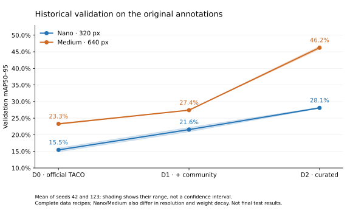
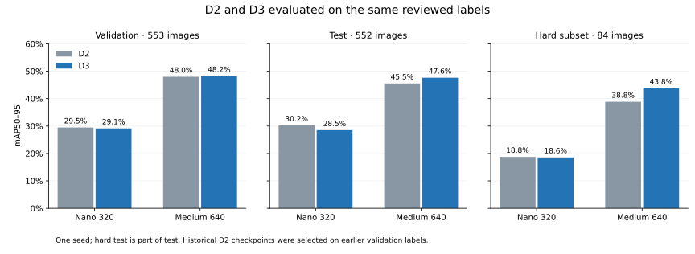

# Trash Vision Lab

Four-material litter detection, from dataset reconstruction and model-assisted
annotation review to an INT8 detector running on a Luckfox Pico Mini A.

The target classes are **plastic, paper, metal and glass**. They are visual
annotation conventions for this project, not a chemical composition or
recyclability assessment.

## What the project demonstrates

- Reconstructing four-material detection labels from the original 60-category
  TACO COCO annotations, with documented mapping and geometry limitations.
- Cleaning and grouping real scenes, adding selected catalog photographs and
  crops to training, and preserving real-only validation/test splits.
- Three-fold YOLO26L hard mining followed by manual annotation review.
- Comparing YOLO26 Nano at 320 px and Medium at 640 px across dataset versions.
- Exporting Nano to RKNN INT8 and implementing camera capture, preprocessing,
  zero-copy NPU inference and decoding on a 64 MB RV1103 board.

## Dataset versions

| Version | Training recipe | Images | Boxes |
| --- | --- | ---: | ---: |
| D0 | Official TACO, original COCO mapped to four materials | 1094 | 2594 |
| D1 | Official + community TACO, same mapping | 4401 | 8621 |
| D2 | Curated scenes, 650 catalog photos and 210 crops | 3431 | 5486 |
| D3 | Same D2 images/splits, reviewed annotations | 3431 | 5807 |

D3 uses a frozen manifest with image/label hashes and group membership.
Its validation split has 553 images / 1067 boxes; test has 552 / 1044.
The 84-image hard subset is part of test, not an additional independent set.
Catalog and crop images occur only in training. The frozen recipe contains
no generated synthetic images.

Images, private recovery evidence and materialized datasets are excluded from
Git. Reproduction follows **source pool → manifest → materialized version**;
access to the corresponding original pools is required.

## Verified historical results

The table below reports **historical validation mAP50–95**, averaged over seeds
42 and 123, on the original D0/D1/D2 evaluation annotations.

| Configuration | D0 | D1 | D2 |
| --- | ---: | ---: | ---: |
| YOLO26n, 320 px | 15.45% | 21.56% | 28.10% |
| YOLO26m, 640 px | 23.29% | 27.42% | 46.23% |



The [13 preserved training CSVs and their checksums](reports/historical/experiments.json)
reproduce these figures with `python scripts/summarize_history.py`.

The deployment candidate is a separate D2 Nano/seed42/WD=0.001 run with
29.73% historical validation mAP50–95. These are not final test results.

## D2 and D3 on the same reviewed holdout

D3 Nano320 and Medium640 each completed 150 epochs, seed 42. The selected
D2 and D3 checkpoints were evaluated on the same 552 test images / 1044 boxes.

| Configuration | D2 test mAP50–95 | D3 test mAP50–95 | Change (pp) |
| --- | ---: | ---: | ---: |
| Nano, 320 px | 30.23% | 28.51% | -1.72 |
| Medium, 640 px | 45.53% | 47.64% | +2.10 |



[All 12 evaluations, per-class AP and provenance](reports/d3/README.md) are retained
along with both complete training CSVs. This is one seed per model; no
statistical significance or isolated causal effect of annotation review is claimed.

D2 Nano remains the deployment candidate: its common-label validation AP is
slightly higher, and its existing RKNN artifact has board evidence. The D3
Nano ONNX/RKNN export is complete and awaits hardware testing. Medium resumed
from its optimizer checkpoint after a network interruption at epoch 122.

Additional validation-only [resolution probing](reports/resolution/README.md)
did not improve either Nano checkpoint by increasing inference size to 640.
A [size-group diagnostic](reports/object-sizes/README.md) finds higher Nano D3
recall at a fixed confidence threshold alongside more false positives; it does
not establish that small training objects are invisible or should be removed.
The optional [unknown-material display](docs/material-abstention.md) has a
measured, modest trade-off and remains disabled by default.

Important interpretation limits:

- D0/D1/D2 compare complete data recipes, including different image membership
  and counts; their differences do not isolate annotation cleanup alone.
- D3 keeps D2 training images but updates annotations. Historical D2 best
  checkpoints were selected on the earlier validation labels, so reevaluation
  on common labels does not turn this into a perfectly controlled retraining
  ablation.
- Nano/Medium also differ in input resolution. Their training wall times on
  different GPUs are not a deployment speed comparison.
- TACO Unlabeled litter was excluded from historical D0/D1 target labels,
  while its pixels remained in the scenes. Composite-material conventions and
  some community coordinate defects are documented baseline limitations.
- Historical mining/review used the broader real-image pool. This limits claims
  of a completely independent retrospective test; see the provenance notes.

## Luckfox Pico deployment

The existing D2 Nano export runs on Luckfox Pico Mini A / RV1103 using RKNN
INT8 and the zero-copy runtime API. A short 30-frame camera benchmark measured
**66.56 ms per frame (~15 FPS)** for the complete pipeline and about 12.2 MB
peak process RSS. The camera saw an empty scene with no detections; this is
a short measurement, not sustained throughput or crowded-scene postprocessing.

On 32 validation images, the PyTorch/RKNN comparison matched 50 detections
from 51 PyTorch and 52 RKNN outputs; mean matched-box IoU was 0.812 and mean
absolute confidence difference was 0.028. This measures export agreement,
not accuracy against ground truth. These measurements belong to the existing
D2 export, not the new D3 model.

The [recovered board runtime and build instructions](docs/luckfox.md) are included.
The portable build was cross-compiled again; fresh hardware testing requires
a connected board.

## Reproduction and navigation

Lightweight repository checks use Python 3.12 and PyYAML; GPU training has
a separate pinned environment:

```bash
python3 -m venv .venv
. .venv/bin/activate
python -m pip install -r requirements.txt
python -m runners.train --model dummy --version v0
python -m unittest discover -s tests -v
```

The eight dataset tests also pass on Windows. GitHub Actions runs those
checks, four rental-guard policy tests, the dummy smoke, decoder checks, and
reconstruction of the historical and common-holdout result tables.

D3 build, pinned training environment and launch commands:
[docs/d3.md](docs/d3.md). The actual GPU recipe is
[configs/d3_training.json](configs/d3_training.json); its training environment
is separate from RKNN export dependencies.

- [Project history and recovered evidence](docs/project-history.md)
- [Original TACO, class mapping and known limitations](docs/taco-provenance.md)
- [D3 dataset and training protocol](docs/d3.md)
- [Experimental unknown-material display and measured trade-off](docs/material-abstention.md)
- [Frozen D3 manifest](manifests/d3.json)
- [Training runner](runners/train_d3.py) and
  [common-holdout evaluation](runners/evaluate_d3.py)

The training and board sources are consolidated here. Training CSVs,
configuration and hash manifests are versioned; original images, credentials
and large model artifacts remain outside Git. Model archives are distributed
through [GitHub Releases](https://github.com/stalker0321/trash-vision-lab/releases),
with both D3 checkpoints, Nano ONNX/RKNN, evaluation evidence and checksums.
The [packaging command](docs/d3.md#model-artifact-archive) verifies their provenance.

## Upstream projects

[TACO](https://github.com/pedropro/TACO) supplies the original litter dataset
and COCO annotations. Detection training uses
[Ultralytics](https://github.com/ultralytics/ultralytics); deployment uses
[Rockchip RKNN](https://github.com/airockchip/rknn-toolkit2) and
[opencv-mobile](https://github.com/nihui/opencv-mobile).
